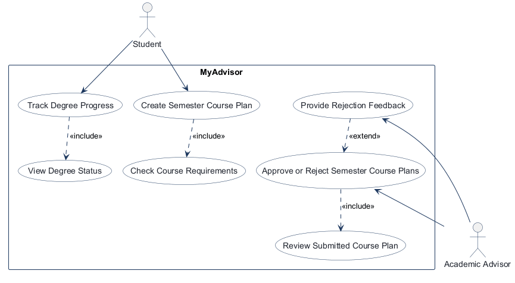
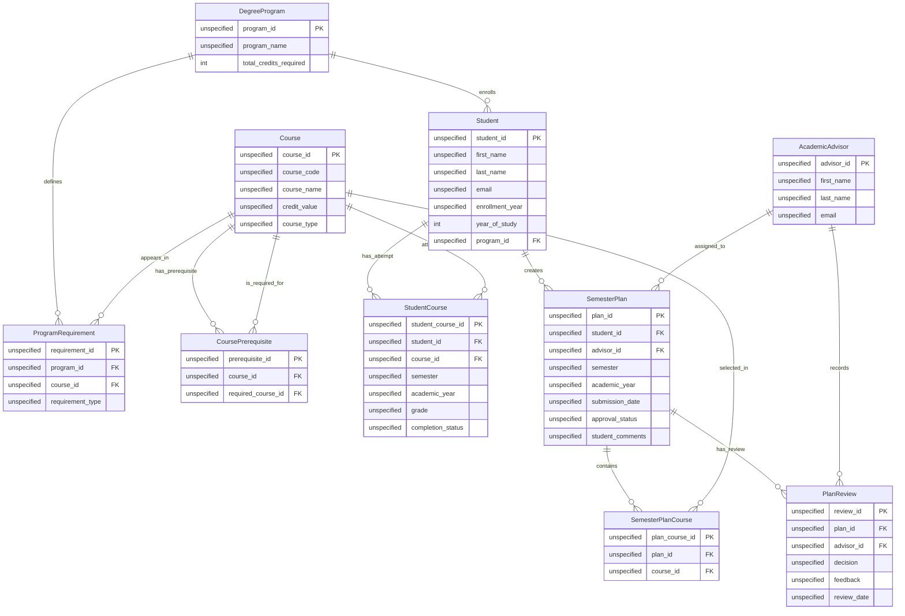
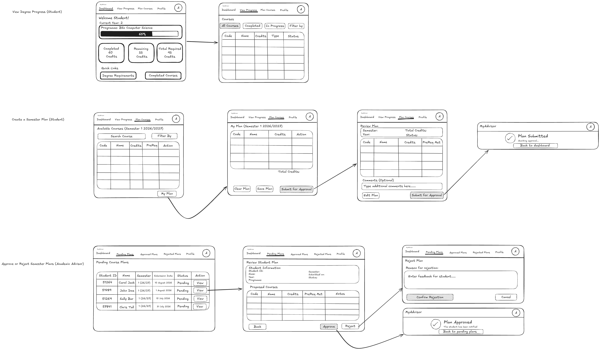

# COMP 3613 Assignment 1

Draft this file with the Guide. **Update it after every phase milestone** before you pause. The use-case diagram is a UML PNG at `docs/diagrams/use-case.png`, linked from this file as `diagrams/use-case.png` (path relative to `docs/report.md`). The model diagram is Mermaid. **Embed wireframe images** as `wireframes/<file>` (files live in `docs/wireframes/`).

Do not put your student ID in this file if you will commit it. The PDF cover adds your name and ID at export time.

## Assigned project
MyAdvisor

## Three workflows
### 1. Track degree progress (Student)

### 2. Approve or reject semester course plans (Academic advisor)

### 3. Create a semester course plan (Student)

## Use case diagram

Phase 2 notes: the Student owns degree tracking and semester planning; the Academic Advisor owns plan approval/rejection. Shared checks are captured via include relationships: degree progress includes viewing current status, and the plan flow includes checking course requirements before submission. The advisor review flow is a separate actor-specific use case focused on the final decision, and "Provide Rejection Feedback" extends that decision when a plan is rejected so feedback is optional and only triggered by the rejection path. No additional major workflow gaps were introduced beyond the named Phase 1 flows.

## Model diagram

Phase 3 first draft, using the student-provided entities and properties. Data types and FK optionality were not specified, so attributes use `unspecified`; revisit the model in Phase 5 if polish requires changes.

Relationship and business-rule notes:

- A student belongs to one degree program; each program can have many students.
- `ProgramRequirement` links programs and courses many-to-many; `requirement_type` belongs to that pairing.
- `CoursePrerequisite` links courses to prerequisite courses many-to-many, with `course_id` as the course being taken and `required_course_id` as its prerequisite.
- `Course.course_type` is `core` or `elective`; legacy `required` values are normalized to `core`.
- Program credit policy: the BSc Computer Science degree requires 93 credits (31 three-credit courses): 21 core courses and 10 elective courses chosen from a 29-course elective pool. The program catalog contains 50 courses in total, so students are not expected to complete every catalog offering.
- `StudentCourse` records course attempts. A student may have multiple records for the same course across different semesters.
- `SemesterPlanCourse` links plans and courses many-to-many. A course can appear at most once in a given plan; enforce uniqueness on `(plan_id, course_id)`.
- `SemesterPlan.advisor_id` identifies the plan's assigned advisor. `PlanReview` stores one or more review decisions for a plan and identifies the advisor who recorded each decision.
- `SemesterPlan.student_comments` stores optional comments the student enters on the review screen before confirming submission.
- `Student.year_of_study` stores the current study year displayed in the advisor's student-information summary; existing profiles default to Year 1, while the seeded demo student is Year 2 as shown in the wireframe.

## Wireframes

### MyAdvisor wireframe set

<!-- student-build:wireframe-coverage
use_case: Track degree progress (Student)
image: docs/wireframes/816043899_wireframes_A1.png
covered: yes
-->

<!-- student-build:wireframe-coverage
use_case: Create a semester course plan (Student)
image: docs/wireframes/816043899_wireframes_A1.png
covered: yes
-->

<!-- student-build:wireframe-coverage
use_case: Approve or reject semester course plans (Academic advisor)
image: docs/wireframes/816043899_wireframes_A1.png
covered: yes
-->

Phase 4 model revisions seen on the wireframe image:

- `StudentCourse.completion_status` — seen on the degree progress screen; completion badges and course status totals imply a persisted completion state.
- `SemesterPlan.approval_status` — seen on the plan review and advisor decision screens; the flow needs a clear approval state for pending/approved/rejected.
- `PlanReview.feedback` — seen on the rejection workflow; the reviewer writes comments before submitting a rejection.
- `SemesterPlan.semester` and `SemesterPlan.academic_year` — seen on the create-plan screen and advisor review summary; these metadata values should be explicit on the plan record.

Design note: the advisor decision flow is visible, but the exact post-decision destination is implied rather than explicit. The plan review screen shows an approval/rejection action and a confirmation state, but the final return path after the decision is not spelled out in the image.

## Theming

Branding preferences: MyAdvisor, academic blue institutional palette, polished student-success tone, and a clean, modern university-facing UI. The public landing page, login, registration pages, and authenticated screens use the MyAdvisor wordmark and a blue/teal academic scheme, with supporting hero copy that reflects advising and degree planning rather than a generic starter app.

The theme was applied through the shared brand tokens in `app/static/css/app.css`, and the same look was carried into the authenticated shell so the app reads as a single advising product instead of a mixed starter template.

## Implementation notes

Phase 5 verified the advising flows against the Phase 4 wireframe decisions and the acceptance criteria for the advisor review flow:

- Approval flow: the advisor can approve a plan from the review screen, the plan status is updated to `approved`, and a dedicated confirmation page displays the outcome with a `Back to Pending Plans` action.
- Rejection flow: the advisor must provide feedback before submitting a rejection. Empty feedback triggers a validation error and keeps the advisor on the same review screen.
- Decision confirmation: after approval or rejection, the advisor is taken to a dedicated confirmation page with the outcome and a Back to Pending Plans action.
- Polish: the authenticated navigation was changed from a collapsible side menu to a horizontal top navigation bar to match the wireframes. Brand consistency, navigation labels, and the advisor review UX were refined to match the academic advising identity and Phase 4 design decisions.
- Advisor navigation: added advisor Dashboard, Pending Plans, Approved Plans, Rejected Plans, Profile, and a circular initials avatar. Status pages show only plans assigned to the signed-in advisor; the avatar links to Profile, and Logout remains available.
- Student navigation and progress polish: aligned the student top bar to Dashboard, View Progress, Plan Courses, Profile, and the circular initials avatar. Dashboard now presents a degree progress bar, completed/remaining/required credit summaries, recent course progress, and semester-plan status. View Progress is a separate course table with All Courses, Completed, and In Progress filters, showing code, name, credits, type, and status. The avatar opens a profile page for either role.
- Student progress type polish: course and program-requirement type defaults are now `core`; existing seeded `required` values are migrated to `core`, and course records can be designated `elective`. The progress table displays the normalized course type.
- Course catalogue sample data: seeded four additional Computer Science courses idempotently: CS220 Database Systems and CS230 Web Application Development (`core`), plus CS260 User Experience Design and CS280 Introduction to Data Science (`elective`). Each is linked to the BSc Computer Science requirements so the student can see them in progress and semester planning.
- Catalogue expansion: expanded the BSc Computer Science catalogue to 50 three-credit courses (21 core + 29 electives), updated the program requirement to 93 credits, and ensured every course is associated with the program as core or elective. The dashboard communicates the 21-core plus 10-of-29-elective completion structure.
- Plan Courses polish: added an Action-column Add button for every available course. Added courses are kept in the signed-in session as an in-progress draft, shown in My Plan with a credit total, and submitted for approval from that review section. The My Plan button is positioned after the available-course table at the bottom of the screen and scrolls to the in-progress draft. The first Submit for Approval action now opens a separate review screen with semester, academic year, credits, prerequisite status, optional advisor comments, an Edit Plan action, and a final submission action. Final submission creates a pending plan and shows a Plan Submitted confirmation page; advisors can see the student's optional comments during plan review. Existing databases receive a nullable `student_comments` column at schema startup. Student verification against the wireframe is pending.
- Student plan details: each semester plan on the student dashboard is now a link to a detail page showing selected courses, total credits, and approval status. The service verifies the plan belongs to the signed-in student before displaying it.
- Advisor plan-review polish: the plan review screen now follows the wireframe's two-column Student Information card (student ID, name, year of study, programme in the left column; semester, submission date, status, and credits in the right) and Proposed Courses table (code, name, credits, prerequisite status, and notes column). Existing student profiles receive a safe Year 1 default; the seeded demo student displays Year 2. Prerequisite status is calculated from completed courses, and optional student comments appear above the course table. Both approval and rejection now lead to dedicated decision confirmation pages with a Back to Pending Plans action.
- Student progress verification requested: compile and whitespace checks pass; student should verify the dashboard, all progress filters, profile link, and plan navigation against the wireframe in the browser.
- Error fixes: implemented the missing default-program repository lookup used by the student dashboard, added the missing advisor dashboard template, added repository lookups used by plan creation, and bound multiple course IDs with FastAPI form fields rather than calling `request.form` synchronously.
- Follow-up error fix: `/admin` returned HTTP 500 because `AcademicAdvisorProfile.user` used an unsupported `Relationship` annotation (`Optional[User]`) that prevented SQLAlchemy mapper initialization. The relationship was not needed by the profile view and was removed; after restarting the app, advisor dashboard, pending, approved, rejected, profile, and student dashboard pages all returned HTTP 200.

This app is a layered FastStarter implementation: the routes stay thin, the existing auth/session flow remains in place, and the advising logic is handled by the repository/service layers for plan status updates, validation, and review creation.

<!-- student-build:code-check
workflow: Approve or reject semester course plans (Academic advisor)
form: mcq
layer: service
architecture_ok: partial
implement_confidence: 0.75
passed: partial
note: Service coordinates the status view; repository owns the database status filter.
-->

<!-- student-build:code-check
workflow: Approve or reject semester course plans (Academic advisor)
form: snippet
layer: model
architecture_ok: yes
implement_confidence: 0.70
passed: no
note: Optional[User] Relationship annotation broke mapper initialization; removed because the profile view needs no ORM relationship.
-->

<!-- student-build:code-check
workflow: Approve or reject semester course plans (Academic advisor)
form: snippet
layer: repository
architecture_ok: yes
implement_confidence: 0.82
passed: yes
note: Added default-program lookup and status-filtered plan query.
-->

<!-- student-build:code-check
workflow: Approve or reject semester course plans (Academic advisor)
form: snippet
layer: service
architecture_ok: yes
implement_confidence: 0.84
passed: yes
note: Service builds advisor plan summaries by delegating status filtering to the repository.
-->

<!-- student-build:code-check
workflow: Approve or reject semester course plans (Academic advisor)
form: snippet
layer: router
architecture_ok: yes
implement_confidence: 0.85
passed: yes
note: Thin dashboard route delegates to the service and renders the advisor view.
-->

<!-- student-build:code-check
workflow: Create a semester course plan (Student)
form: choice
layer: other
architecture_ok: yes
implement_confidence: 0.62
passed: yes
note: Chose an in-progress draft that the student reviews before submitting.
-->

<!-- student-build:code-check
workflow: Create a semester course plan (Student)
form: mcq
layer: service
architecture_ok: yes
implement_confidence: 0.68
passed: yes
note: Identified the service as the place to coordinate duplicate prevention and adding a course to the draft.
-->

<!-- student-build:code-check
workflow: Create a semester course plan (Student)
form: snippet
layer: model
architecture_ok: yes
implement_confidence: 0.76
passed: yes
note: Added a unique constraint on each SemesterPlanCourse plan/course pair.
-->

<!-- student-build:code-check
workflow: Create a semester course plan (Student)
form: snippet
layer: service
architecture_ok: yes
implement_confidence: 0.81
passed: yes
note: Validates the course and returns a deduplicated draft selection.
-->

<!-- student-build:code-check
workflow: Create a semester course plan (Student)
form: snippet
layer: router
architecture_ok: yes
implement_confidence: 0.84
passed: yes
note: Thin add handler calls the service and retains the selection in the session.
-->

## Deployed app

Phase 6. Public Render URL (not localhost). Markers open this to mark the three workflows.

https://

## Logins

Every account a marker needs, including extra users you added. Starter accounts:

- bob / bobpass — regular user
- admin / adminpass — admin

## YouTube URL

## Session transcripts

Filled when the Guide builds the report: the agent writes each Guide chat to `docs/transcripts/<slug>.md` (Copilot Agent, Cursor, or OpenCode). `python manage.py report` packages them. Do not paste chats here during the build.

## Competency (student-judge)

Filled when the report is built. Guide runs student-judge, writes `docs/judge.md`, and export appends the scorecard here.

## Skill integrity

Filled by `python manage.py report`. Do not edit the course skills.
